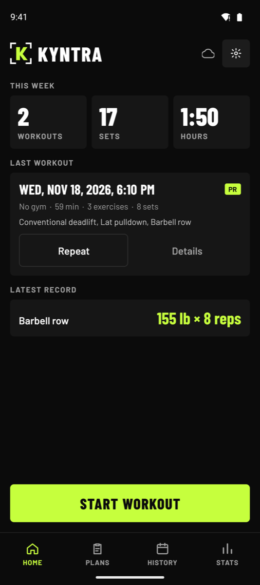
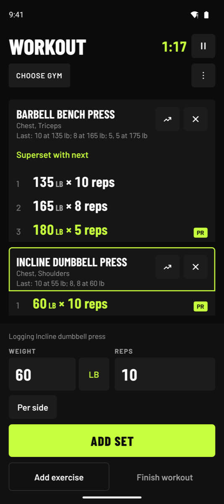
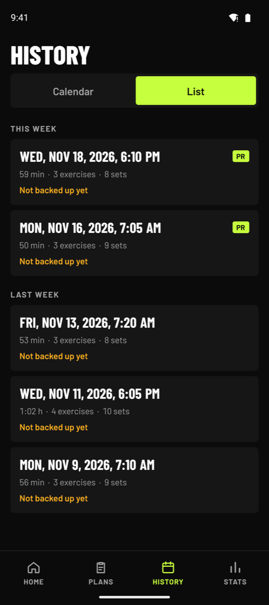
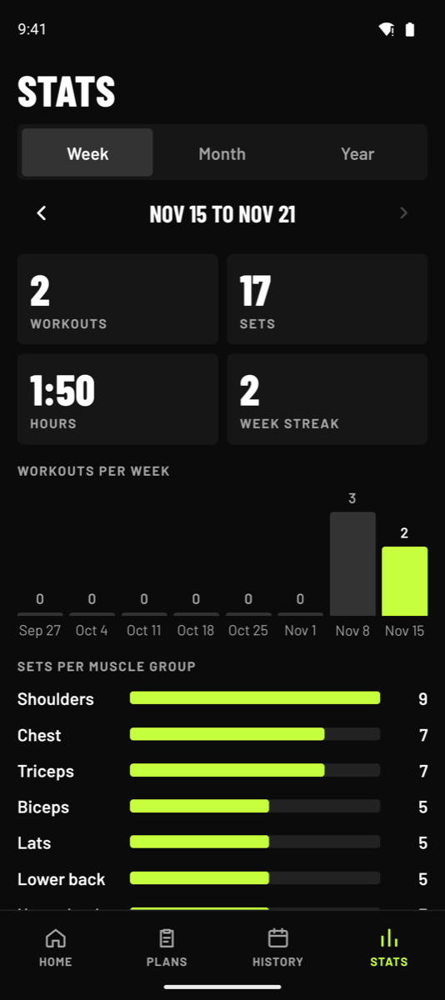
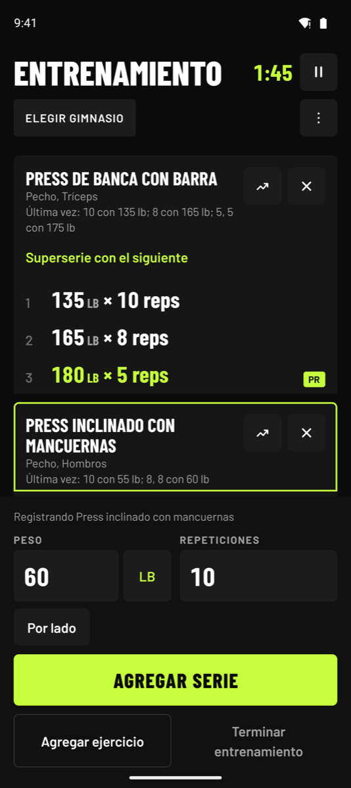
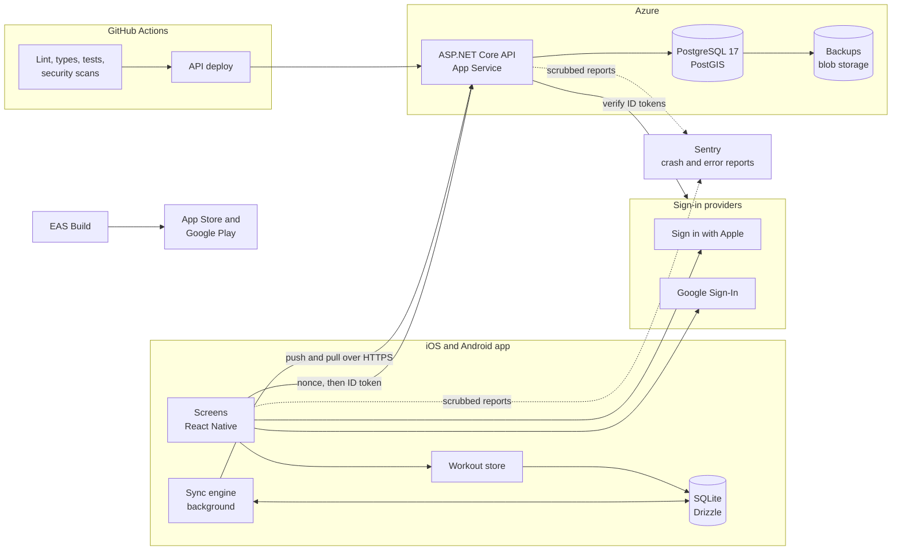

# Kyntra

An offline-first gym workout log for iOS and Android. In English and Spanish, in beta.

**Try it:** TestFlight: `[TODO: add the public TestFlight link]` · Google Play: `[TODO: add the Google Play testing link]` ·
Website: [kyntra.fit](https://kyntra.fit)

  
  
  
  
  

## What Kyntra is

Kyntra is a workout log built for the gym floor: start a workout, pick an exercise, log weight and reps in a tap.
Everything works with no signal. Each change is written to SQLite on the phone first and synced to the server in
the background, so a basement gym with no reception is not a problem.

- Logs weight and reps, reps only, time, or distance and time, with supersets and rep ranges.
- Keeps the unit the person typed (kg or lb) next to a normalized kilogram value. It never converts what they
  entered.
- Shows what you did last time, personal records, weekly volume and history.
- Plans, gyms and custom exercises.
- A guest can log a first workout with no account. Sign-in is Apple or Google only, and guest data moves into the
  account at sign-in.
- English and Spanish, with locale-aware numbers and dates, large text support and screen reader labels.

## My role

I am the sole engineer. I took Kyntra from the first design through to production builds on the App Store and
Google Play:

- the mobile app (React Native, Expo, TypeScript),
- the API (ASP.NET Core on .NET 10),
- the database (PostgreSQL 17 with PostGIS),
- the cloud setup on Azure, written as code,
- CI/CD with GitHub Actions and EAS Build,
- release work: store listings, privacy declarations, crash reporting and incident fixes.

## Stack

| Front end | Back end |
| --- | --- |
| React Native with Expo (dev builds, EAS Build), TypeScript in strict mode | ASP.NET Core on .NET 10, a modular monolith with minimal APIs |
| SQLite on the phone through expo-sqlite and Drizzle ORM, with committed migrations | PostgreSQL 17 with PostGIS, EF Core with Npgsql |
| A local store with memoized rows, FlashList for long lists | Per-user advisory locks and snapshot reads for sync |
| i18next with English and Spanish, device locale formatting | ProblemDetails errors, rate limiting, structured logging |
| Jest and React Native Testing Library, with render budgets for the logging path | xUnit integration tests on Testcontainers PostgreSQL |
| A TypeScript API client generated from the API's OpenAPI document | OpenAPI document kept in step by a test |
| Sentry for crash reports, with personal data scrubbed | Sentry for error reports, with the same scrubbing |

Shared: Azure (App Service and a PostgreSQL VM with point in time backups), GitHub Actions for CI and deploys,
Sign in with Apple and Google, Sentry.

## Architecture

The logging screen only talks to SQLite. Nothing on that path waits for the network: adding or editing a set is
one local write, rendered from the result. The sync engine runs beside it and the UI only asks it to sync soon.

The API is one ASP.NET Core application split into modules (users, workouts, sync, gyms, equipment, billing), each
with its own endpoints and services, talking through interfaces. A test checks the module boundaries. The API keeps
no state between requests, so it can scale out.

## How sync works offline

- Every row has a client-generated UUIDv7 key, an `updated_at`, a soft delete time, a local `dirty` flag and a
  local `rev` counter. Retrying a push is always safe: the same row sent five times is one upsert.
- **Push:** the app sends unsynced rows oldest first, parents before children, 200 per request. Each row gets its
  own answer (`applied`, `unchanged`, `stale`, `deleted` or `rejected`), so one bad row never blocks the rest. The
  dirty flag is cleared only if the row was not edited again while the push was in flight.
- **Pull:** the app asks for changes after its cursor. The server numbers every change from one sequence, holds a
  per-user lock while a push commits so numbers commit in order, and reads all tables in one snapshot, so a cursor
  never skips a row. A test found the snapshot was needed.
- **Conflicts:** last writer wins per row on `updated_at`. A delete wins over an edit whatever the times say, and a
  deleted row never comes back. The same rules run on the server and on the phone.
- **Days offline:** old timestamps are accepted as sent. A time more than 24 hours ahead of the server clock is
  refused, so a phone with a wrong clock cannot beat every later edit.
- **Status:** a cloud icon on History, filled or outlined. No dialogs, ever, about sync.

More in [adr/0009-sync-design.md](adr/0009-sync-design.md).

## Security and privacy

- **Sign-in:** Apple and Google only. The API verifies the ID token itself (signature, issuer, audience, expiry,
  nonce) and issues its own short-lived access token and a rotating refresh token. Refresh tokens are stored only as
  a SHA-256 hash, and reuse of a rotated token revokes the whole session.
- **Server-issued, single-use nonces:** the app asks the API for a nonce before opening Apple's or Google's sheet.
  The API stores only its hash for 10 minutes and accepts it once, with one atomic delete, so a captured ID token
  cannot be replayed. See [adr/0052](adr/0052-server-issued-sign-in-nonces.md) and
  [the engineering note](engineering-notes/sign-in-token-replay.md).
- **Isolation:** every query is scoped by the user id from the token, never from the request. Synced tables are keyed
  by `(user_id, id)`, and an integration test checks one user cannot read another's data.
- **What is stored:** an account is an id and the provider's account id. No name, email or photo from Apple or
  Google is kept. Raw user coordinates are never stored. Workout history is private.
- **What is not stored:** tokens in plain form, nonces in plain form, IP addresses in logs. Logs never hold
  coordinates, weights, tokens or free text.
- **Crash reports with no personal identifiers:** errors only, no tracing or session replay. A scrubber on each side
  removes users, headers, query strings, bodies, emails, tokens and coordinates before a report leaves, and the
  native install ids the SDKs add are cleared on the phone.
- **On the phone:** tokens live in the Keychain or Keystore through expo-secure-store. Location is asked for only at
  workout start, in the foreground, with a manual fallback.

## How I work

- **CI gates.** One required check, `ci passed`, sits on top of path-filtered jobs: lint, Prettier, the TypeScript
  type check, migration drift, both Jest projects, `dotnet format`, a Release build, the API tests, a check that the
  generated API client matches the OpenAPI document, gitleaks, OSV-Scanner, Semgrep and a NuGet vulnerability gate.
  Draft pull requests get the light checks, and marking one ready runs the full suite. Deploys are a manual
  workflow from `main` with OpenID Connect to Azure, no stored cloud keys.
- **ADRs.** Every decision that affects later work gets a short architecture decision record, 55 so far. Four are in
  [adr/](adr/).
- **Release checks from real failures.** Each production build problem left a check behind:
  - the ABI check reads the Android App Bundle and fails if any ABI is missing a native library
    ([note](engineering-notes/android-crash-from-a-single-abi-library.md)).
  - the EAS config check pins one Node version across local, CI and the build server and loads the production
    config as EAS does ([note](engineering-notes/node-version-on-the-build-server.md)).
  - the purpose string check searches the iOS native code for APIs that need an Info.plist purpose string and fails
    if one is missing, before App Store Connect would refuse the upload.
- **Tests with each feature.** The latest runs: 3,072 app tests and 217 render performance tests, and 1,490 API
  tests. Performance targets (for example, adding a set under 50 ms on a mid-range Android phone) have timing marks
  and render budgets in the tests.
- **Incidents get written up.** Cause, how it was found, the fix and what now prevents it. Four are in
  [engineering-notes/](engineering-notes/).
- I use Claude Code in my workflow, and every change goes through review, tests and CI before it merges.

## What is here

| Folder | What it holds |
| --- | --- |
| [code/](code/) | Selected excerpts from the API, the app, the release tooling and CI, with their tests. [code/README.md](code/README.md) explains each one |
| [adr/](adr/) | Four architecture decision records, lightly edited for outside readers |
| [engineering-notes/](engineering-notes/) | Four one-page writeups of real problems and their fixes |
| [screenshots/](screenshots/) | The app on an Android emulator, with guest test data |

## About the code here

The full source is private. The files in [code/](code/) are selected excerpts, copied as they are on `main`, so
they do not build on their own. I am happy to walk through the full codebase in an interview.

Planned and not shown here: equipment scanning, ads, premium features and the gym data import.

## License

All rights reserved. The code is shared for review only. No license is granted to use, copy or modify it.

Contact: support@kyntra.fit
